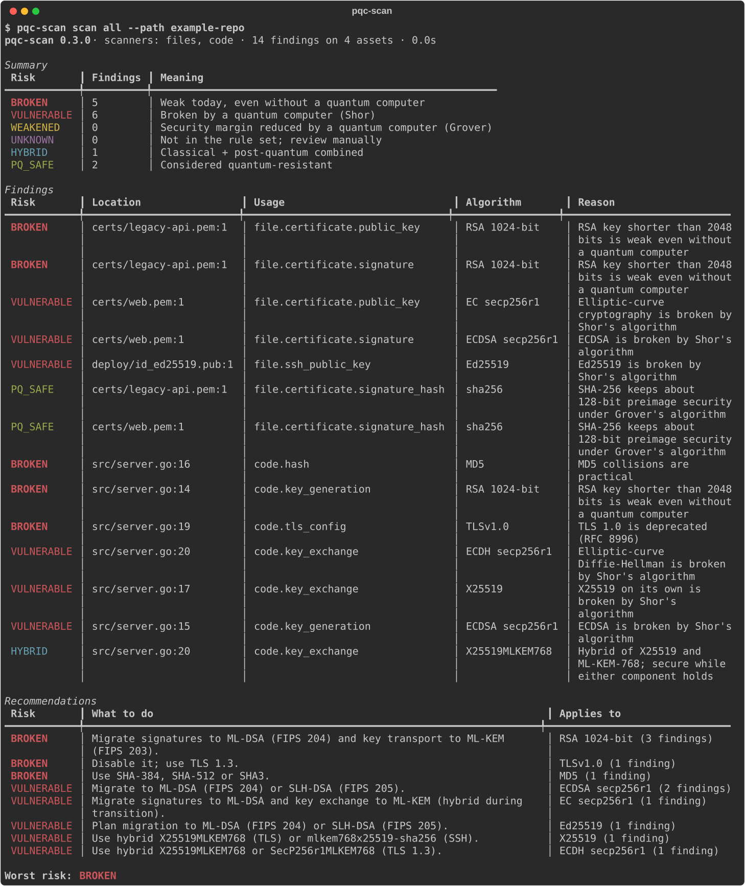

# pqc-scan

**Find quantum-vulnerable cryptography in your endpoints, key files and source
code, and plan your post-quantum migration.**



> ⚠️ **Authorised use only.** Only scan systems you own or have written
> permission to test. `pqc-scan` performs passive discovery: it reads handshake
> metadata, never logs in, never guesses passwords and never attempts
> exploitation.

## Why

A large enough quantum computer will break RSA, elliptic-curve cryptography and
Diffie–Hellman (Shor's algorithm) and weaken symmetric keys (Grover's
algorithm). Data recorded today can be decrypted later ("harvest now, decrypt
later"). Migrating to the NIST post-quantum standards — ML-KEM (FIPS 203),
ML-DSA (FIPS 204) and SLH-DSA (FIPS 205) — starts with knowing where classical
cryptography is used. `pqc-scan` builds that **cryptographic inventory** and
exports it as a CycloneDX **CBOM**.

## What it scans

| Scanner | Input | Finds |
| --- | --- | --- |
| `tls` | `host[:port]` | Protocol versions, every accepted cipher suite, key-exchange groups including hybrid `X25519MLKEM768`, DHE size, certificate chain |
| `ssh` | `host[:port]` | Key exchange (e.g. `mlkem768x25519-sha256`), host keys, ciphers, MACs |
| `code` | directory | Crypto API usage in Python, Java/Kotlin, JavaScript/TypeScript and Go |
| `files` | directory | PEM/DER certificates, CSRs, keys, OpenSSH keys, `authorized_keys`, `known_hosts` |

No external tools are needed: TLS and SSH are probed with small pure-Python
clients, code is analysed with Python's `ast` and data-driven pattern rules.
**Private key contents and source lines are never reported** — only path,
line, type and size.

## Risk classes

| Class | Meaning | Examples |
| --- | --- | --- |
| `BROKEN` | Weak even without a quantum computer | MD5, SHA-1 signatures, RC4, 3DES, TLS 1.0, RSA < 2048 |
| `VULNERABLE` | Broken by Shor's algorithm | RSA, ECDSA, ECDH, Ed25519, X25519, DH, DSA |
| `WEAKENED` | Security margin halved by Grover's algorithm | AES-128, HMAC-SHA1 |
| `UNKNOWN` | Not in the rule set; needs manual review | |
| `HYBRID` | Classical and post-quantum combined | X25519MLKEM768, mlkem768x25519-sha256 |
| `PQ_SAFE` | Considered quantum resistant | ML-KEM, ML-DSA, SLH-DSA, AES-256, SHA-384 |

All classification lives in one data file,
[`rules/algorithms.yaml`](src/pqc_scan/rules/algorithms.yaml).

## Installation

```bash
pip install "pqc-scan[report] @ git+https://github.com/YusufTaha-Kurt/pqc-scan"
```

(`pip install "pqc-scan[report]"` once it is published on PyPI.) Python 3.11+.
The `[report]` extra adds the HTML and CBOM formats.

Or with Docker:

```bash
docker build -t pqc-scan .
docker run --rm pqc-scan scan tls example.com
docker run --rm -v "$PWD:/scan:ro" pqc-scan scan all --path .
```

## Usage

```bash
pqc-scan scan files ./my-repo                        # keys and certificates
pqc-scan scan code  ./my-repo                        # crypto API calls in source
pqc-scan scan tls   example.com mail.example.com:465 # TLS endpoints
pqc-scan scan ssh   git.example.com                  # SSH servers
pqc-scan scan all --path ./my-repo --tls example.com --ssh git.example.com
```

Every command takes the same output options:

| Option | Purpose |
| --- | --- |
| `--format console\|json\|html\|cbom` | Terminal table (default), machine-readable JSON, one-file HTML page, CycloneDX 1.6 CBOM |
| `--out FILE` | Write to a file instead of the terminal |
| `--fail-on CLASS` | Exit with code 1 if a finding is at least this severe (for CI) |
| `--targets FILE` | Read targets from a file (`scan all`: `tls://…`, `ssh://…`, `path:DIR`) |
| `--timeout`, `--concurrency` | Network limits (defaults: 5 s, 10 parallel targets) |
| `--exclude GLOB` | Skip paths (added to `.git`, `node_modules`, `.venv`, …) |
| `--mosca-x/-y/-z`, `--mosca-file` | Migration urgency (see below) |

Saved JSON reports can be re-rendered or compared:

```bash
pqc-scan report report.json --format html --out report.html
pqc-scan diff base.json head.json --fail-on BROKEN   # only NEW findings count
```

Exit codes: `0` success · `1` `--fail-on` reached · `2` usage error ·
`3` every target failed.

Example outputs for a small sample project are in [`examples/`](examples/).

### Migration urgency (Mosca's inequality)

Data is at risk when **x + y > z**: x = years the data must stay secret,
y = years the migration takes, z = years until a cryptographically relevant
quantum computer. You supply all three — pqc-scan never assumes a quantum
timeline.

```bash
pqc-scan scan all --path . --mosca-x 10 --mosca-y 5 --mosca-z 12
pqc-scan scan all --path . --mosca-file mosca.yaml --mosca-z 12
```

```yaml
# mosca.yaml — first matching glob (on location or asset id) wins
default: {x: 5, y: 3}
assets:
  - match: "tls://*.bank.example:*"
    x: 25
  - match: "src/payments/*"
    x: 10
```

## In CI: GitHub Action

```yaml
name: pqc-scan
on: [push, pull_request]
jobs:
  scan:
    runs-on: ubuntu-latest
    steps:
      - uses: actions/checkout@v4
        with: {fetch-depth: 0}
      - uses: YusufTaha-Kurt/pqc-scan@v0.3.0
        with:
          path: .
          exclude: "tests/fixtures"
          fail-on: BROKEN     # on pull requests: only findings new in the PR
```

The action writes a job summary, uploads the report as an artifact
(`format: html|json|cbom`) and exposes `worst-risk` as an output. Inputs:
`path`, `tls`, `ssh`, `exclude`, `fail-on`, `only-new`, `format`,
`python-version`, `upload-artifact`.

## Documentation

- [Migration guide](docs/migration-guide.md) — what to change, with nginx, Apache, OpenSSH and Go examples
- [System definition](docs/architecture.md) — how it works
- [Learn notebooks](docs/learn/) — Grover, Shor and BB84 in plain Python
- Turkish: [kullanım kılavuzu](docs/kullanim-kilavuzu.md) · [teknik özet](docs/teknik-ozet.md) · [kuantum rehberi](docs/kuantum-rehberi.md)
- [Changelog](CHANGELOG.md) · [Contributing](CONTRIBUTING.md) · [Security policy](SECURITY.md)

## Development

```bash
python -m venv .venv && .venv/bin/pip install -e ".[dev]"
.venv/bin/ruff check . && .venv/bin/ruff format --check . && .venv/bin/mypy src
.venv/bin/pytest -q --cov=pqc_scan
```

Tests never touch the internet: TLS and SSH scanners are tested against local
servers, and all keys are generated at test time.

## License

[Apache-2.0](LICENSE)
